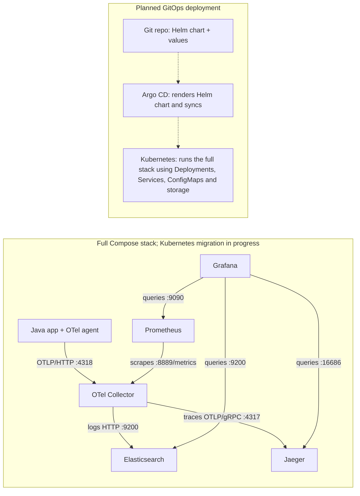

# Local observability lab

Java 21 + OpenTelemetry on Podman Desktop/Ubuntu WSL. **Compose runs the full stack.** Kind currently runs the Java app and Collector with debug output; Helm, Argo CD, and Kubernetes data stores are next.

## Architecture



Solid arrows show telemetry delivery, scraping, and queries; dashed arrows show the planned deployment flow. Kubernetes currently runs only the Java app and debug Collector. Compose and Kubernetes service names resolve within their own networks.

## Start

Requires Podman Desktop, Ubuntu's `podman` and `/usr/bin/podman-compose`, and Windows `podman.exe` accessible from WSL.

```bash
bash setup.sh
```

Select/create a Podman machine; the script discovers its socket, builds images, and starts Compose. Its exported connection settings last only for that script.

**Option A — Podman Desktop:** Inspect Compose resources under **Containers**. For Kind, use a rootful machine and context `kind-observability-lab`; inspect **Kubernetes → Pods**.

**Option B — WSL CLI:** Export `CONTAINER_HOST` for the selected engine before separate Podman commands. Windows `kubectl.exe` uses Desktop's kubeconfig:

```bash
kubectl.exe config use-context kind-observability-lab
kubectl.exe apply -f "$(wslpath -w k8s)"
```

First load `localhost/java-app-lab:1` and `localhost/otel-collector-setup-lab:1` into Kind via **Images → ⋮ → Push image to Kind cluster**, or `kind.exe load docker-image <image> --name observability-lab` using the same engine. Their pull policy is `Never`.

## Ports

TCP mappings below describe the lab; **internal** means no host publication.

| Host → destination | Listener / purpose |
| --- | --- |
| `8000 → 8000` | Compose Java HTTP server: `http://localhost:8000/hello-world`. |
| `3000 → 3000` | Grafana HTTP dashboards/API. |
| `9090 → 9090` | Prometheus HTTP UI, query API, and self-metrics. |
| `16686 → 16686` | Jaeger HTTP UI/query API; Grafana uses `http://jaeger:16686`. |
| `9200 → 9200` | Elasticsearch HTTP API: Collector writes logs; Grafana queries them. Local lab authentication is disabled. |
| Internal `otel-collector:4318` | OTLP/HTTP receiver for Java metrics, logs, and traces; Kubernetes Service forwards to Pod port `4318`. |
| Internal `otel-collector:8889/metrics` | Compose Collector exposes metrics for Prometheus to scrape every **15s**. Disabled in the Kubernetes pipelines for now. |
| Internal `jaeger:4317` | OTLP/gRPC trace receiver used by the Compose Collector. |
| Internal Jaeger `4318` / `8888` | Alternative OTLP/HTTP receiver / Jaeger's own operational metrics. |
| `9091 → 80`, `9443 → 443` | Kind node HTTP/HTTPS ingress mappings; no ingress controller is currently deployed. |
| Loopback `62782 → 6443`* | Kubernetes HTTPS API for `kubectl`. |
| Local `50000 → Pod 8000`* | Desktop app port-forward: `http://localhost:50000/hello-world`. |
| Optional local `8004 → Pod 8000` | CLI alternative: `kubectl.exe port-forward svc/hello-world-app 8004:8000`. Keep it running. |

*API/automatic forwarding ports can change; check `kubectl.exe cluster-info` and Desktop's **Port Forwarding** page. Image-declared ports (for example `55679`, Elasticsearch `9300`, and legacy Jaeger ports) are not host mappings or proof of enabled listeners.*

`0.0.0.0` binds all container/Pod interfaces. `containerPort` documents a port; application configuration starts its listener. A Service selects Pods by labels; port-forwarding tunnels through the Kubernetes API to a selected Pod.

## Configuration and persistence

- Kubernetes mounts ConfigMap `otel-collector-configmap` as `/etc/otelcol-contrib/collector.yaml`. This avoids image rebuilds for settings, distributes config across nodes, and lets Pods share it. Keep definitions in Git; apply changes and restart the Collector to reload them.
- Compose configuration is baked into images; rebuild/recreate after edits. Grafana loads fixed data source UIDs and `dashboards/*.json`; export UI edits back to Git. Trace panels search `hello-world-app`, avoiding stale fixed IDs.
- Named volumes persist Grafana, Prometheus, Jaeger Badger traces, and Elasticsearch logs. `compose down` preserves them; `down -v` deletes them. Agent exports, Prometheus scraping, and dashboard refresh have separate intervals.
- **Compatibility:** Jaeger is pinned to **2.20.0** with Grafana **13.3.0** for this lab's legacy query API compatibility ([issue](https://github.com/grafana/grafana-jaeger-datasource/issues/87)).

## References

[Java agent](https://opentelemetry.io/docs/zero-code/java/agent/getting-started/) · [Collector](https://opentelemetry.io/docs/collector/configuration/) · [Prometheus](https://prometheus.io/docs/prometheus/latest/configuration/configuration/) · [Grafana provisioning](https://grafana.com/docs/grafana/latest/administration/provisioning/) · [ConfigMaps](https://kubernetes.io/docs/tasks/configure-pod-container/configure-pod-configmap/) · [Kind](https://kind.sigs.k8s.io/docs/user/quick-start/) · [Podman/WSL](https://podman-desktop.io/docs/podman/accessing-podman-from-another-wsl-instance) · [Helm](https://helm.sh/docs/topics/charts/) · [Argo CD](https://argo-cd.readthedocs.io/en/stable/user-guide/helm/)