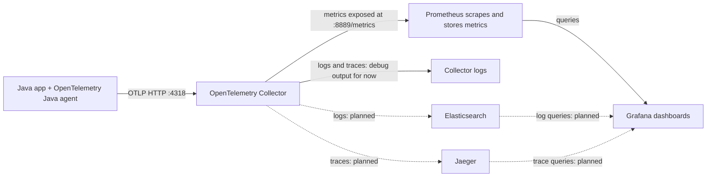

# Local observability lab

A learning project for running application observability locally with Podman. The current lab collects metrics from a small Java HTTP server and displays them with Grafana. The planned backends are Elasticsearch for logs and Jaeger for traces; deployment automation comes later.

## Architecture



The arrows into Grafana represent **queries**: Grafana reads metrics from Prometheus and, later, logs from Elasticsearch and traces from Jaeger. Grafana does not store these signals. Helm, Argo CD, and Kubernetes belong to a separate future **deployment flow**; they do not receive telemetry from Grafana.

| Component | Job in this lab |
| --- | --- |
| Java app | Serves HTTP requests and writes application log records. |
| OpenTelemetry Java agent | Instruments the app without adding OpenTelemetry calls to the Java source. It captures HTTP metrics and traces, and bridges supported Java logging frameworks. |
| OpenTelemetry Collector | Receives OTLP data and routes each signal through a configured pipeline. Its `debug` exporter prints received telemetry for verification. |
| Prometheus | Scrapes numeric time series and stores them for querying. It is not a log database. |
| Elasticsearch (planned) | Will store application logs. |
| Jaeger (planned) | Will store and serve traces for inspection. |
| Grafana | Queries data sources and shows metrics, logs, and traces. |

## What is running now

- The Java app sends telemetry to the Collector on the Podman `observability` network.
- The Collector's metrics pipeline exposes metrics on port `8889`; Prometheus scrapes that endpoint every 15 seconds.
- Prometheus and its Collector target are reachable in the Prometheus UI at <http://localhost:9090/targets>. Both targets should show **UP**.
- Grafana is at <http://localhost:3000>. Its Prometheus data source can graph the app's HTTP request count.
- The Collector's traces and logs pipelines currently use `debug`. They do not store data in a trace or log backend.
- `app/TestServer.java` includes `java.util.logging` request messages. Rebuild/recreate the app container after code changes, then verify those log records in Collector output. Elasticsearch and Jaeger have not been added yet.

The current configuration is in [`otel/collector.yaml`](otel/collector.yaml) and [`prometheus/prometheus.yaml`](prometheus/prometheus.yaml). The app source is [`app/TestServer.java`](app/TestServer.java), and its image definition is [`Containerfile`](Containerfile). The dashboard export is in [`dashboards/local-observability-lab.json`](dashboards/local-observability-lab.json).

## Addresses and timing

| Address | Who uses it | Purpose |
| --- | --- | --- |
| `http://localhost:8002/` | Your browser | The app container published to the Windows host. |
| `http://otel-collector:4318` | Java agent inside the Podman network | Collector OTLP/HTTP receiver. The agent adds `/v1/metrics`, `/v1/traces`, or `/v1/logs`. |
| `http://otel-collector:8889/metrics` | Prometheus inside the Podman network | Collector's Prometheus exporter. |
| `http://localhost:9090` | Your browser | Prometheus UI/API. |
| `http://localhost:3000` | Your browser | Grafana UI. |

The `otel-collector` hostname resolves inside the `observability` Podman network. It is not a Windows browser hostname. Port `8889` has not been published to the host; seeing its target **UP** in Prometheus is the useful check.

Three intervals are independent:

1. The Java agent's default periodic metric export interval is **60 seconds**. It can be changed with `OTEL_METRIC_EXPORT_INTERVAL` (milliseconds).
2. `scrape_interval: 15s` in `prometheus/prometheus.yaml` makes Prometheus poll its targets every **15 seconds**. The default path is `/metrics`; use `metrics_path` on a scrape job if the target serves another path.
3. Grafana refreshes a dashboard when requested or when a dashboard refresh interval is set. Refreshing Grafana more often does not make the Java agent export sooner.

## OpenTelemetry settings

The app image starts Java with `-javaagent:otel/opentelemetry-javaagent.jar`. That JAR contains the agent and its automatic instrumentation. The `Containerfile` sets the metrics and traces exporters to `console` for early testing; the app container connected to the Collector overrides those settings at runtime:

```text
OTEL_METRICS_EXPORTER=otlp
OTEL_TRACES_EXPORTER=otlp
OTEL_LOGS_EXPORTER=otlp
OTEL_EXPORTER_OTLP_ENDPOINT=http://otel-collector:4318
```

`otlp` chooses the telemetry protocol/exporter. `OTEL_EXPORTER_OTLP_ENDPOINT` chooses its destination. With the Java agent's OTLP/HTTP default, the signal-specific paths are appended automatically. Setting a logs exporter only determines where **captured** logs go; it does not turn `System.out.println` text into OpenTelemetry log records.

The Java agent supports `java.util.logging` (JUL) and enables its logging bridge by default. Use a `java.util.logging.Logger` in the app to emit log records. The bridge captures those records, and the configured OTLP exporter sends them to the Collector. `OTEL_JAVAAGENT_LOGGING` controls the agent's own diagnostics; it is different from application logging.

## Check the metrics path

1. Visit <http://localhost:8002/> several times.
2. Check <http://localhost:9090/targets>: the `otel-collector` target should be **UP**. The query `up{job="otel-collector"}` should return `1`.
3. In Grafana **Explore**, select the Prometheus data source and query:

   ```promql
   http_server_request_duration_seconds_count{job="otel-collector"}
   ```

   This is a cumulative request count for the current app process. It changes when the agent exports another metric batch and Prometheus scrapes it.

## Podman Desktop and WSL CLI

The repo is edited in the Ubuntu WSL distribution. Podman Desktop runs its containers in a **different** WSL-backed Podman machine named `grafana-test`. Plain `podman` in Ubuntu uses Ubuntu's local Podman engine, which has a different container store.

**Option A — Podman Desktop:** Use the `grafana-test` machine to inspect containers, read logs, and restart them. The Collector image has no `/bin/sh`, so use its **Logs** tab rather than its Terminal tab.

**Option B — WSL CLI:** Define this Bash function once per terminal session to send commands to the same machine that Desktop shows:

```bash
pd() { podman --remote --url unix:///mnt/wsl/podman-sockets/podman-grafana-test/podman-root.sock "$@"; }
pd ps
```

When a config file changes in the WSL repo, copy it into the appropriate container and restart that container. The source file is `.yaml` for Prometheus, while the destination inside its image is `.yml`:

```bash
pd cp otel/collector.yaml otel-collector:/etc/otelcol/config.yaml
pd restart otel-collector

pd cp prometheus/prometheus.yaml grafana-prometheus-test:/etc/prometheus/prometheus.yml
pd exec grafana-prometheus-test promtool check config /etc/prometheus/prometheus.yml
pd restart grafana-prometheus-test
```

Use `pd logs --tail 30 otel-collector` to inspect Collector output. Copying files into running containers is fine for this lab, but it is not a durable deployment method: recreating a container discards changes in its writable layer. A later Compose/Quadlet or Kubernetes setup should mount or bake versioned configuration from the repo.

## Next stages

1. Rebuild the Java image with the updated JUL logger, run it with the OTLP environment settings above, and confirm an application log record reaches the Collector's `logs` pipeline.
2. Add Elasticsearch as the log store and route the Collector's logs pipeline to it. The Elasticsearch exporter is in the **contrib** Collector distribution, so this requires changing from the current core Collector image or choosing another compatible ingest path. Add Elasticsearch as a Grafana data source.
3. Add Jaeger as the trace backend. Route the Collector's traces pipeline to Jaeger's OTLP receiver, then add Jaeger as a Grafana data source. Traces are currently printed only by `debug`.
4. Make local startup reproducible, then learn Helm, Kubernetes, and Argo CD as a separate deployment layer.

## References

- [OpenTelemetry Java agent setup](https://opentelemetry.io/docs/zero-code/java/agent/getting-started/) and [JUL logging bridge](https://explorer.opentelemetry.io/java-agent/instrumentation/java-util-logging)
- [Java 21 `Logger` API](https://docs.oracle.com/en/java/javase/21/docs/api/java.logging/java/util/logging/Logger.html)
- [OpenTelemetry Collector configuration](https://opentelemetry.io/docs/collector/configuration/) and [Prometheus exporter](https://github.com/open-telemetry/opentelemetry-collector-contrib/blob/main/exporter/prometheusexporter/README.md)
- [OpenTelemetry OTLP exporter settings](https://opentelemetry.io/docs/languages/sdk-configuration/otlp-exporter/) and [metric export interval](https://opentelemetry.io/docs/specs/otel/configuration/sdk-environment-variables/)
- [Prometheus overview](https://prometheus.io/docs/introduction/overview/) and [scrape configuration](https://prometheus.io/docs/prometheus/latest/configuration/configuration/)
- [Grafana data sources](https://grafana.com/docs/grafana/latest/datasources/) and [dashboard refresh](https://grafana.com/docs/grafana/latest/visualizations/dashboards/use-dashboards/)
- [OpenTelemetry Collector Elasticsearch exporter](https://github.com/open-telemetry/opentelemetry-collector-contrib/blob/main/exporter/elasticsearchexporter/README.md) and [Elasticsearch data source in Grafana](https://grafana.com/docs/grafana/latest/datasources/elasticsearch/configure/)
- [Jaeger deployment and OTLP receiver](https://www.jaegertracing.io/docs/2.22/deployment/) and [Jaeger data source in Grafana](https://grafana.com/docs/grafana/latest/datasources/jaeger/configure/)
- [Podman Desktop: access a Podman machine from another WSL distribution](https://podman-desktop.io/docs/podman/accessing-podman-from-another-wsl-instance)
