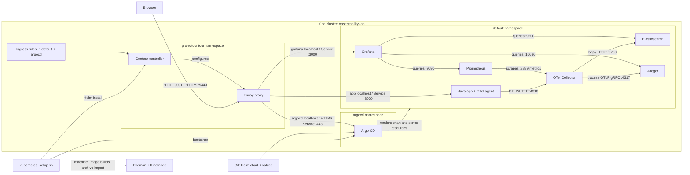

# Local observability lab

A local SRE learning project: a Java 21 HTTP app sends metrics, logs, and traces through OpenTelemetry to Prometheus, Elasticsearch, and Jaeger. Grafana visualizes them. The full stack runs in a single-node Kind Kubernetes cluster on Podman, with Contour ingress and Argo CD GitOps.

**Supported setup:** Windows + Ubuntu WSL2. Run the shell scripts from Ubuntu. They mix Linux tools with Windows `podman.exe`, `kind.exe`, `kubectl.exe`, and `curl.exe`; they are not generic Linux/macOS installers.

## Tools and Uses

| Tool | Role in this lab |
| --- | --- |
| Podman / Podman Desktop | Builds container images and runs the Linux machine containing the Kind node. Desktop provides a GUI for inspection. |
| Compose | Defines the alternative container-only stack and supplies image build definitions to the Kubernetes script. |
| Kind | Runs real Kubernetes inside containerized nodes; creates the cluster and imports image archives. |
| Kubernetes / kubectl | Kubernetes schedules and maintains Pods. kubectl is the client for inspecting resources and applying manifests. |
| Helm | Packages and templates Kubernetes resources. The script installs Contour with Helm; Argo CD renders the observability chart. |
| Argo CD | Reads the chart from Git and synchronizes the application resources into Kubernetes. It does not build images. |
| Ingress / Contour / Envoy | Ingress resources declare hostname/path routes. Contour watches those rules and configures Envoy. Envoy receives and forwards the HTTP/HTTPS requests. |
| OpenTelemetry Java agent | Instruments the Java process and exports its telemetry using OTLP/HTTP. |
| OpenTelemetry Collector | Receives telemetry, exposes metrics for scraping, and exports logs and traces to their backends. |
| Prometheus | Scrapes and stores numeric time-series metrics; supports PromQL queries. |
| Elasticsearch | Stores application log records for searching. |
| Jaeger | Stores and queries request traces and their spans. |
| Grafana | Queries the backends and displays dashboards, logs, and traces. |

## Architecture and pipeline



**Deployment:** the script builds images, creates/reuses Kind, imports images, installs Contour and Argo CD, and creates the Argo CD Application. Argo CD fetches the chart from Git and applies its resources. The script waits for Synced/Healthy and checks all three Windows-facing routes.

**Requests and telemetry:** browser -> Kind host mapping -> Envoy -> application Service -> Pod. A Java request produces telemetry sent to the Collector. Prometheus pulls metrics every 15 seconds; the Collector pushes logs to Elasticsearch and traces to Jaeger. Grafana queries all three.

The application Ingress resources live in `default`; Argo CD's Ingress lives in `argocd`. Contour watches them across namespaces. Namespaces group resources, not nodes: all these Pods share one node. `contour.ingressStatusAddress: 127.0.0.1` reports the local entry address so Argo CD can assess Ingress health; it does not create routing or DNS.

## Download and install prerequisites

| Where | Install / make available |
| --- | --- |
| Windows | [WSL2 + Ubuntu](https://learn.microsoft.com/en-us/windows/wsl/install), [Podman Desktop](https://podman-desktop.io/docs/installation/windows-install), and Windows Podman. Podman 6.2.0+ includes the Windows stale API socket fix. |
| Windows, accessible from WSL | `podman.exe`, [Kind](https://podman-desktop.io/docs/kind/installing-the-kind-cli) (`kind.exe`), [kubectl](https://kubernetes.io/docs/tasks/tools/install-kubectl-windows/) (`kubectl.exe`), and `curl.exe`. Podman Desktop's CLI tools/Kind extension can help install these. |
| Ubuntu WSL | Bash, Git, Podman client, `podman-compose`, OpenSSL, and [Linux Helm](https://helm.sh/docs/intro/install/). `base64`, `tr`, `grep`, `mktemp`, and `wslpath` must be available. |

In Ubuntu 24.04, install the distribution packages with:

```bash
sudo apt update
sudo apt install -y git podman podman-compose openssl curl ca-certificates
```

Install Helm using its linked official guide. The script expects the Compose provider at `/usr/bin/podman-compose`. No host Java, Go, Docker engine, or Argo CD CLI is required; Java compilation happens inside the image build.

Your Ubuntu user needs access to the Podman machine's shared socket. For the standard rootful Ubuntu/Podman setup, grant membership in GID 10, then exit and reopen the WSL session:

```bash
sudo usermod --append --groups 10 "$(whoami)"
```

See the [official WSL socket-permissions guide](https://podman-desktop.io/docs/podman/accessing-podman-from-another-wsl-instance). The group is normally named `uucp` in Ubuntu. These permissions are a prerequisite, not something the script changes automatically.

## Clone and run

From Ubuntu WSL:

```bash
mkdir -p ~/projects
cd ~/projects
git clone https://github.com/LegitAgent/grafana-sub-blueprint.git
cd grafana-sub-blueprint
bash kubernetes_setup.sh
```

Select an existing **rootful** Podman machine or choose **Create new**. New-machine prompts default to 4 CPUs, 6144 MiB memory, and 50 GiB disk; actual resource handling depends on the WSL/Podman provider. Leave ports `9091` and `9443` free, and stop other lab machines using them before testing a new environment.

The script creates/reuses cluster `observability-lab`, context `kind-observability-lab`, and writes its connection file to `~/.kube/observability-lab.yaml`. It uses `podman save` -> `kind load image-archive`; `kind load docker-image` expects source images in Docker.

**Git is the application source of truth.** `argocd/observability-lab.yaml` currently points to this repository's default branch (`HEAD`) and `helm-charts/observability-lab`. If using a fork, change `repoURL` to your fork. Commit and push chart/value changes before expecting Argo CD to deploy them. An offline or private repository needs additional access configuration.

### Open the applications

| URL | Login / use |
| --- | --- |
| http://app.localhost:9091/hello-world | Refresh to generate requests and telemetry. `/` is also available. |
| http://grafana.localhost:9091 | Fresh database: `admin` / `admin`, then change the password. Existing databases retain their credentials. |
| https://argocd.localhost:9443 | Username `admin`; the script prints the command to retrieve its initial password. |

Argo CD ingress uses a self-signed certificate. The browser warns until you explicitly trust it. The script verifies HTTPS using the generated certificate without changing Windows trust settings. Local certificate/key files are outside Git at `~/.local/share/observability-lab/tls/`; they are reused, valid for one year when generated, and not automatically renewed.

### Inspect and retrieve the initial password

For additional commands in a new WSL terminal, define this helper:

```bash
labkubectl() {
    kubectl.exe \
        --kubeconfig "$(wslpath -w "$HOME/.kube/observability-lab.yaml")" \
        --context kind-observability-lab "$@"
}

labkubectl get pods -A
labkubectl get pvc -n default
labkubectl get application observability-lab -n argocd
```

Get the initial Argo CD password without saving it to a file:

```bash
labkubectl -n argocd get secret argocd-initial-admin-secret \
    -o jsonpath='{.data.password}' | base64 --decode
```

This is the bootstrap password, not necessarily the current password after it has been changed. Use the script's printed command if preferred. When manually pasting Windows UNC paths into Bash, single-quote them so leading backslashes survive.

**Podman Desktop:** Kubernetes -> select `kind-observability-lab` -> Pods/Services; filter `default`, `projectcontour`, or `argocd`. The outer Kind node appears under Containers. No manual browser port-forwarding is required for the three ingress URLs.

### Verify telemetry

Generate app requests, then use Grafana with a recent time range:

- **Metrics:** open the metrics dashboard; export, 15-second scraping, and dashboard refresh are separate intervals.
- **Logs:** Explore -> Elasticsearch -> `body.text:*`.
- **Traces:** Explore -> Jaeger -> Search -> service `hello-world-app`, operation All. Trace IDs identify requests; searching by service avoids hardcoded IDs.

The setup's route checks verify Java's response, Grafana database health, and the Argo CD HTTPS UI. They do not prove every telemetry record reached its backend.

## Ports

All entries are TCP. Internal Services are reachable inside Kubernetes, not directly on Windows.

| Host or internal address | Listener / purpose |
| --- | --- |
| Windows `127.0.0.1:9091` -> node `80` | Envoy HTTP ingress for Java and Grafana, selected by hostname. |
| Windows `127.0.0.1:9443` -> node `443` | Envoy HTTPS ingress for Argo CD. |
| Assigned host API port -> node `6443` | Kubernetes HTTPS API; recorded in kubeconfig, not fixed at `62782`. |
| `hello-world-app:8000` | Java HTTP Service -> Pod `8000`. |
| `grafana:3000` | Grafana UI and query API -> Pod `3000`. |
| `otel-collector:4318` | OTLP/HTTP ingestion of application metrics, logs, and traces. |
| `otel-collector:8889/metrics` | Prometheus-format application metrics endpoint. |
| `prometheus:9090` | Prometheus queries, UI, and self-metrics. |
| `elasticsearch:9200` | HTTP API: Collector writes logs; Grafana queries them. |
| `jaeger:4317` | OTLP/gRPC trace ingestion. |
| `jaeger:16686` | Jaeger UI/query API used by Grafana. |
| Jaeger Pod `4318` / `8888` | Configured alternative OTLP/HTTP ingestion / Jaeger self-metrics; not published by its Service. |
| Envoy Pod `8080` / `8443` | HTTP/HTTPS proxy listeners, reached through node host ports `80` / `443`. |
| `argocd-server:443` (also `:80`) -> Pod `8080` | Argo CD HTTPS UI/API. A Service port is not necessarily the container port. |
| Argo CD Pod `8083` | Server metrics; not the login UI. |

`containerPort` describes the expected listener; the application starts it. `Service.port` is the stable cluster-facing port; `targetPort` is the receiving Pod port. Other Argo CD/Contour components also have internal control/metrics ports installed by their upstream manifests; these are not browser entry points.

## Configuration, persistence, and updates

The observability chart currently requests **three Java replicas** and one replica of each backend. The namespaces are `default` (application), `projectcontour` (ingress infrastructure), and `argocd` (GitOps controller).

| Data | PVC | Request | Container mount |
| --- | --- | --- | --- |
| Metrics | `prometheus-data` | 2Gi | `/prometheus` |
| Grafana database | `grafana-data` | 1Gi | `/var/lib/grafana` |
| Traces | `jaeger-data` | 1Gi | `/var/lib/jaeger` |
| Logs | `elasticsearch-data` | 2Gi | `/usr/share/elasticsearch/data` |

The `standard` StorageClass uses local-path provisioning. Requests are initial estimates, not enforced disk quotas. PVC-backed data survives Pod replacement; deleting the Kind cluster or its Podman machine loses local storage. Jaeger keeps primary traces for 48 hours and archived traces for 30 days; the archive is not populated automatically. Elasticsearch authentication is disabled for this local lab.

- **Chart/values:** edit, commit, and push. Argo CD auto-syncs and self-heals drift; automatic pruning is disabled. Do not alternate routine direct Helm upgrades with Argo CD management of the same application.
- **ConfigMaps:** supply Collector, Prometheus, and Jaeger settings independently of images. Syncing a mounted file does not guarantee process reload; restart/reload the affected workload when needed.
- **Java/dashboard/image changes:** update the image tag consistently in Compose build definitions, chart values, and the script's `images` array; rebuild and import it into Kind before syncing that Git change. Reusing `:1` does not automatically replace running Pods. Export Grafana UI dashboard edits back into `dashboards/`; provisioning uses fixed data source UIDs.
- **Separate bootstrap resources:** the script manages Contour, Argo CD installation, and Argo CD's ingress. The observability Application does not manage these itself.

Pinned lab versions include Grafana **13.3.0**, Jaeger **2.20.0** (kept for the query-API compatibility tested in this lab), Collector **0.165.0**, Elasticsearch **9.5.6**, Argo CD **3.6.2**, and Contour chart **0.9.0**. Prometheus's base image and Kind's default node image are not currently pinned, so fresh builds are not fully version-reproducible.

## Alternative: Compose only

After installing the Podman/WSL prerequisites, run `bash local_setup.sh`. This starts the container-only stack from `compose.yaml`, without Kind, Argo CD, or ingress. Use `localhost:8000` for Java, `:3000` for Grafana, `:9090` for Prometheus, `:16686` for Jaeger, and `:9200` for Elasticsearch. Choose this or Kubernetes for normal use rather than running duplicate stacks unnecessarily.

## Startup and troubleshooting

**After a reboot:** start your selected Podman machine and its existing `observability-lab-control-plane` container. Kubernetes restores the deployed workloads; rebuilding is only necessary for image changes. Desktop offers Start under Resources/Containers. From WSL, replace the example machine name:

```bash
machine=observability-fresh-test
(
    cd /mnt/c
    podman.exe machine start "$machine"
)
podman.exe --connection "${machine}-root" start observability-lab-control-plane
```

| Symptom | Check / action |
| --- | --- |
| Missing command | Install the prerequisite in the correct OS; Linux `podman` and Windows `podman.exe` are different clients. |
| Socket permission denied | Check the shared socket's group and your WSL group membership; reopen the session after granting access. |
| WSL cannot translate an Ubuntu UNC working directory | Run Windows machine-init/start operations from `/mnt/c`; the Kubernetes script's `machine_cmd` helper does this. |
| Images absent / Desktop appears empty | Confirm the selected machine and rootful connection. Images in Podman are separate from images imported into Kind. |
| Ingress stays Progressing | Check Contour's `ingressStatusAddress` and the Ingress ADDRESS; reporting an address does not itself prove connectivity. |
| Healthy Pods but empty response/timeouts in the browser | Check host ports, Envoy, and Podman forwarding. Stale netavark rules were encountered when switching test environments. The script fails its HTTP checks rather than clearing firewall rules automatically. |
| Certificate warning | Expected for the local self-signed certificate; always use `https://argocd.localhost:9443`. |
| A temporary forwarded port stops working | Recreate the forwarding session. On a Pod/Deployment, Argo CD uses `8080`; its Service exposes `443`. |

Do not delete machines, remove PVCs, or flush firewall rules as routine troubleshooting. Back up data before destructive cleanup. A separate fresh-test machine preserves the working lab, but stop other machines using the same host ports.

## Repository map and references

`app/`: Java source. Component folders: Containerfiles and configuration. `dashboards/`: exported dashboards. `helm-charts/observability-lab/`: application chart. `argocd/`: Application and UI Ingress. `kind-config.yaml`: node/host mappings. `contour-values.yaml`: ingress infrastructure values. `archive/k8s/`: earlier standalone manifests, not the current deployment source.

[Java agent](https://opentelemetry.io/docs/zero-code/java/agent/getting-started/) · [Collector](https://opentelemetry.io/docs/collector/configuration/) · [Prometheus](https://prometheus.io/docs/prometheus/latest/configuration/configuration/) · [Grafana provisioning](https://grafana.com/docs/grafana/latest/administration/provisioning/) · [Jaeger](https://www.jaegertracing.io/docs/2.20/) · [Elasticsearch](https://www.elastic.co/docs/deploy-manage/deploy/self-managed/install-elasticsearch-docker-basic) · [Kind](https://kind.sigs.k8s.io/docs/user/configuration/) · [Contour](https://projectcontour.io/getting-started/) · [Kubernetes storage](https://kubernetes.io/docs/concepts/storage/persistent-volumes/) · [Argo CD automated sync](https://argo-cd.readthedocs.io/en/stable/user-guide/auto_sync/)
