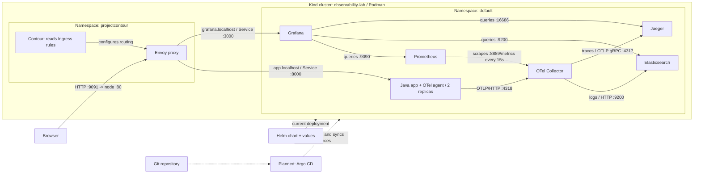

# Local observability lab

A local SRE learning lab built with Java 21, OpenTelemetry, Grafana, Prometheus, Jaeger, and Elasticsearch. The full stack now runs on a single-node Kind Kubernetes cluster backed by Podman on Windows/Ubuntu WSL. Helm manages the application resources; Contour and Envoy provide browser access.

Setup automation is in progress. Installation instructions will follow once the scripts and Argo CD integration are ready.

## Architecture

Solid arrows show current connections; dashed arrows show planned GitOps deployment. Ingress routes target Services, which select application Pods. Internal Service addresses resolve inside the cluster; they are not Windows host ports.

## Access and ports

| Address / port | Purpose |
| --- | --- |
| `http://app.localhost:9091` | Java app through ingress; `/` and `/hello-world` generate telemetry. |
| `http://grafana.localhost:9091` | Grafana dashboards through the same ingress entry point. |
| Host `9091` -> node `80` | Envoy HTTP host port; the requested hostname selects the backend. |
| Host `9443` -> node `443` | Reserved Kind mapping; HTTPS ingress is currently disabled. |
| `hello-world-app:8000` | Internal Java HTTP Service, routing to either replica. |
| `grafana:3000` | Internal Grafana HTTP UI/API Service. |
| `otel-collector:4318` | OTLP/HTTP receiver for application metrics, logs, and traces. |
| `otel-collector:8889/metrics` | Prometheus-format metrics endpoint scraped by Prometheus. |
| `prometheus:9090` | Internal Prometheus query API, UI, and self-metrics. |
| `jaeger:4317` | Internal OTLP/gRPC trace ingestion. |
| `jaeger:16686` | Internal Jaeger UI/query API used by Grafana. |
| `elasticsearch:9200` | Internal HTTP API for storing and querying logs. |
| Jaeger Pod `4318` / `8888` | Configured OTLP/HTTP receiver / Jaeger self-metrics; not exposed by its Service. |
| Host API port -> node `6443` | Kubernetes HTTPS API; host port is assigned during cluster creation. |

A `containerPort` declaration documents the expected listener; the application must actually listen there. Internal traffic needs no host port-forwarding. Compose remains an alternative local environment with host ports `8000`, `3000`, `9090`, `16686`, and `9200`.

## Configuration and storage

- `helm-charts/observability-lab/` contains the chart, component templates, and image/replica values. The default namespace runs two Java replicas and one replica of each observability component.
- ConfigMaps supply Collector, Prometheus, and Jaeger configuration independently of their images. Configuration changes may require a process reload or Pod restart.
- Grafana provisioning and `dashboards/*.json` are baked into its custom image. Data source UIDs are fixed; export UI edits back to these files before rebuilding. Trace searches use service `hello-world-app` instead of a fixed trace ID.
- Separate PVCs store Prometheus metrics (`2Gi`), Grafana's database (`1Gi`), Jaeger Badger traces (`1Gi`), and Elasticsearch logs (`2Gi`). These are initial requests, not measured capacity requirements or enforced local-path disk quotas. Data survives Pod replacement, but deleting the Kind cluster removes its local storage.
- Jaeger retains primary traces for 48 hours and archived traces for 30 days; archive storage does not automatically archive every trace. Elasticsearch authentication is disabled for this local lab.
- Jaeger remains pinned to **2.20.0** and Grafana to **13.3.0**, matching the versions tested together in this lab.

## Repository and next steps

`app/` holds the Java source; component folders hold image build files and configuration. `compose.yaml` retains the Compose environment, `contour-values.yaml` configures the separate ingress Helm release, and `archive/k8s/` preserves the original standalone manifests.

Planned work: finish the setup scripts, add Argo CD, and document the resulting setup flow. Argo CD will sync manifests from Git; image building and delivery into Kind remain separate responsibilities.

## References

[Java agent](https://opentelemetry.io/docs/zero-code/java/agent/getting-started/) · [Collector](https://opentelemetry.io/docs/collector/configuration/) · [Prometheus](https://prometheus.io/docs/prometheus/latest/configuration/configuration/) · [Grafana provisioning](https://grafana.com/docs/grafana/latest/administration/provisioning/) · [Jaeger](https://www.jaegertracing.io/docs/2.20/) · [Elasticsearch](https://www.elastic.co/docs/deploy-manage/deploy/self-managed/install-elasticsearch-docker-basic) · [Kubernetes storage](https://kubernetes.io/docs/concepts/storage/persistent-volumes/) · [Kind](https://kind.sigs.k8s.io/docs/user/quick-start/) · [Contour](https://projectcontour.io/getting-started/) · [Helm](https://helm.sh/docs/topics/charts/) · [Argo CD](https://argo-cd.readthedocs.io/en/stable/user-guide/helm/)
